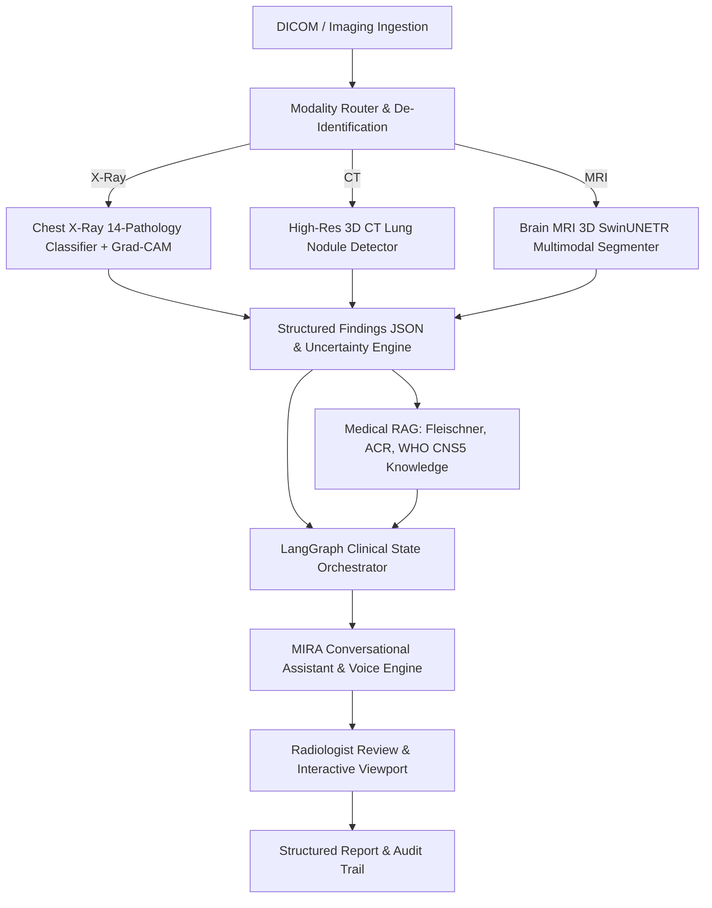

# MEDVISION AI & MIRA Assistant

**Multimodal AI Radiology Assistant & Clinical Decision-Support Platform**

> **IMPORTANT CLINICAL & LEGAL DISCLAIMER:**  
> MedVision AI is a research-oriented clinical decision-support prototype. AI-generated findings and reports are not a substitute for professional medical judgment. All results require review by a qualified healthcare professional. MIRA is strictly an AI co-pilot/assistant and is never a substitute for a licensed radiologist or physician.

---

## 🔬 Architectural Overview

MedVision AI orchestrates deep learning models (MONAI / PyTorch), stateful clinical decision workflows, medical RAG, and an intelligent Jarvis-inspired AI co-pilot (**MIRA**):



---

## 🚀 Key Features

1. **Multimodal Medical Vision:**
   - **Brain MRI**: 3D SwinUNETR segmentation of Whole Tumor (WT), Tumor Core (TC), and Enhancing Tumor (ET) with volume quantification.
   - **Chest CT**: 3D High-Resolution Lung Nodule detection, HU windowing, and Fleischner Society guideline matching.
   - **Chest X-Ray**: 14-Pathology multi-label classification (Pleural Effusion, Cardiomegaly, Atelectasis, Pneumothorax, etc.) and Grad-CAM saliency.
2. **MIRA Conversational Co-Pilot:**
   - Jarvis-inspired calm, economical persona with real-time proactive narration.
   - Grounded strictly in structured vision model outputs and verified medical literature.
   - Web Speech API (Push-to-Talk STT) and SpeechSynthesis TTS voice layer.
   - Non-negotiable safety guardrails preventing definitive diagnosis generation.
3. **Medical RAG Engine:**
   - Semantic retrieval with source citations across Fleischner Society, ACR, and WHO CNS5 guidelines.
4. **Radiologist Review & DICOM Viewport:**
   - Multi-slice navigation, window/level presets, 3D segmentation mask toggles, and Grad-CAM heatmaps.
   - Interactive structured report generation with digital sign-off and audit logging.

---

## 🛠️ Quickstart & Local Setup

### 1. Requirements
- Python 3.10+
- Modern Web Browser (Chrome / Firefox / Safari / Edge)

### 2. Run Locally
```bash
# Start backend server & UI on port 8085
python3 -m uvicorn backend.app.main:app --host 0.0.0.0 --port 8085 --reload
```
Open **[http://localhost:8085](http://localhost:8085)** in your browser.

### 3. Run Automated Test Suite
```bash
python3 -m pytest backend/tests/unit/test_core_pipeline.py
```
